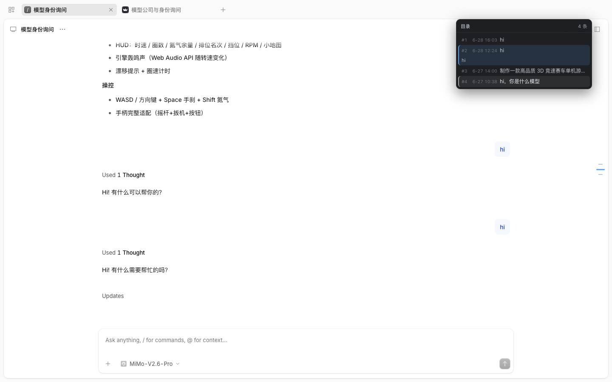

# OpenCode SideBar

English | [简体中文](README.md)

> An OpenChamber-style **prompt navigator rail** for the official opencode web UI
> (`opencode web` / `opencode serve`): a column of evenly spaced ticks on the right
> of the conversation timeline — **one tick per user message**. Move the mouse along
> the rail to map the Y axis to the nearest tick, click to jump to that point in the
> conversation, and the turns adjacent to the current viewport are highlighted.



A pure Chrome extension (Manifest V3) that injects only content scripts:

- **No background process**, **no extra permission prompts**
- **No data sent to any external address** — everything comes from the
  same-origin opencode HTTP API

---

### Installation (the only manual step)

1. Open `chrome://extensions` in the Chrome address bar
2. Enable **Developer mode** (top right)
3. Click **Load unpacked** and select this project folder
   — or clone this repository and select the cloned directory
4. Open / refresh any opencode session page; the rail appears on the right

> Note: Chrome 137+ stable disables the `--load-extension` command-line flag, so
> automated tests run on Edge (the extension itself is a standard MV3 content script
> using no browser-private APIs — manual loading in Chrome behaves identically).

### Where it applies

Default matches (`content_scripts.matches` in `manifest.json`, any port):

- `http://localhost/*`, `http://127.0.0.1/*`
- `https://localhost/*`, `https://127.0.0.1/*`

If your opencode web is deployed on another domain/URL, edit `matches`
(and `host_permissions`) in `manifest.json`, then hit **Reload** on the extensions page.

### Behavior

| Interaction        | Behavior                                                                                                                                                                                                                                                                                                       |
| ----------------- | -------------------------------------------------------------------------------------------------------------------------------------------------------------------------------------------------------------------------------------------------------------------------------------------------------- |
| Tick source       | Same-origin message API: first tries the current `GET /api/session/{id}/message`; falls back to the legacy `GET /session/{id}/message` (bare array) when the response is non-JSON, malformed, or the `data` array is **empty**. An empty array is not authoritative — some deployments answer the `/api/` path with `{"data":[],"cursor":{…}}` while the real data lives on the legacy path (observed: 407 messages / 14 user messages). Handles both `{data:[...]}` and bare arrays, and both `type:"user"` and `info.role` shapes; one tick per user message, evenly spaced in chronological order (12px gap) |
| TOC panel         | Hovering the rail for 200ms pops a panel on its left listing **all** user messages (beyond the 30-tick window): `#index  time  one-line preview`, with the total count on top; the panel scrolls internally and the active row auto-scrolls into view; **top-anchored** — it grows downward on hover so rows don't shift                                           |
| Hover linkage     | Two-way sync between rail and TOC rows (`setHover`); the hovered row **expands in place** to show the full preview (≤600 chars / ~6 lines) instead of a native `title` tooltip; the matching tick widens and turns blue; hovering outside the 30-tick window pans the window to include it                                                                                                                    |
| TOC row click     | Jumps via `ocJumpTo`, the **panel stays open** (consecutive jumps), and the active row follows by scrolling                                                                                                                                                                                                                                                          |
| Panel dismissal   | Closes 250ms after the pointer leaves rail + panel; `Esc` closes immediately                                                                                                                                                                                                                                                                             |
| On-screen cap     | At most 30 ticks, windowed around the current turn (edge fade masks)                                                                                                                                                                                                                                                                                    |
| Theme-aware colors| The page background luminance is annotated as `light/dark` on `#oc-rail-host[data-oc-theme]`: dark pages use gray ticks + white active; light pages (`rgb(250,250,250)`) use slate gray + near-black active + deep blue hover. The original white active tick was white-on-white on light backgrounds — completely invisible                                                                                       |
| Visibility self-recovery | Whenever the timeline fails to render `[data-timeline-row]` (remount, virtualization rebuild, window resize) the rail hides; geometry updates (1s watchdog) re-show it. Previously only active changes / new messages triggered a repaint, so the lines stayed gone until the user scrolled to another turn                                                                                                                         |
| No render before first layout | The host element stays hidden until it receives timeline geometry (`updatePosition`) — a `position:fixed` element without `left/top` lands at its static position (off-screen), which looks the same as "all lines gone"                                                                                                                                       |
| Whole-rail hover  | Mouse Y → nearest tick; the hit tick widens and turns blue; cleared on leave                                                                                                                                                                                                                                                                            |
| Click             | Sets `location.hash = message-<id>`, using the app's own hash navigation (the app handles virtualized scrolling and historical pagination itself); when the target hash equals the current value, a two-step (clear-then-set) ensures the app sees the change; if the target row is still out of the viewport after 1.5s, it falls back to `scrollIntoView`                                                                                                                           |
| Active-turn highlight | The topmost user row visible below the sticky header (sticky header height is measured dynamically to avoid misjudging the hidden previous row); **scrolled to the bottom = the last message** (matching the app's own semantics); follows scrolling via rAF throttle                                                                                                       |
| Session switching | URL/session changes automatically unmount and rebuild; going home unmounts; new messages (an unknown id found by MutationObserver) incrementally refresh the ticks                                                                                                                                                                                                |

A page counts as a session when the path contains `/session/ses_` and the timeline
(`[data-scrollable]` + `[data-timeline-row]`) exists.

### Debugging

- Logs in the page console are prefixed with `[oc-rail]`;
- The `data-oc-status` attribute on the host element `#oc-rail-host` is a JSON status
  (`mounted / sessionID / tickCount / activeIndex / hoverIndex / tocVisible / jumpCount / errors`),
  readable across isolated/main worlds — inspect it directly in the page console:

```js
JSON.parse(document.getElementById("oc-rail-host").dataset.ocStatus)
```

- The `data-oc-theme` attribute on the same element is `light` / `dark` (derived from the
  page background luminance) and drives the tick colors; when you suspect "the lines are
  invisible", check `style.visibility` and `data-oc-theme` first.
- Errors are also recorded in the `errors` field and printed via `console.error`.

### Directory layout

```
manifest.json      MV3 manifest (content_scripts + host_permissions only)
src/debug.js       Status namespace, logging, cross-world status mirror
src/api.js         Session id parsing + user-message list fetch
src/jump.js        Hash navigation (two-step + fallback)
src/rail.js        Shadow DOM rail rendering, Y→tick mapping, sticky-header measurement, TOC panel
src/main.js        Lifecycle orchestration: mount/unmount, scroll/Resize/Mutation observers, refresh
tools/             Development & test tooling (not part of the extension runtime)
toc-screenshot.png Interface screenshot used in this README
README.md          中文说明
README.en.md       English documentation
LICENSE
```

### Development / test tooling (`tools/`)

- `serve.mjs` — discovers the local `opencode serve` port and Basic-auth password from the
  process table (OpenChamber picks a random port on every start)
- `e2e.mjs` — real-extension end-to-end run (28 assertions: mount, tick count = API message
  count, TOC open/close/reopen, hover row expansion + tick highlight, remote window panning,
  click jump + panel stays open, active row scroll-following, `Esc` close, zero errors)
  - Run: `node tools/e2e.mjs [sessionID]`; requires Edge (Chrome 137+ disables `--load-extension`)
  - On a `zh` locale, opencode web session pages crash on `Intl.ListFormat` (an app-side bug),
    so the test forces `locale: en-US`
- `probe-dom.mjs` — opens a session page and reports the DOM facts the extension relies on
  (scroller / row count / mount status)
- `debug-scroller.mjs` / `debug-geom.mjs` / `debug-hover.mjs` — focused probes:
  scroller ancestor chain, rail geometry time series, TOC hover event flow and hit testing
- `debug-ticks.mjs` / `debug-ticks-zoom.mjs` — tick visibility probes: host/tick geometry and
  computed styles, mask values, hit testing; 6x zoomed crops (to diagnose "the line is drawn
  but invisible" contrast issues)
- `debug-hidden.mjs` — reproduces "all lines disappear": briefly stops the timeline from
  rendering any row, verifying the rail hides and recovers on its own
- `debug-api.mjs` — prints the real message-endpoint responses (status code / Content-Type /
  top-level shape / role histogram / samples) to verify the parsing assumptions in `src/api.js`
- `probe-remote.mjs` / `probe-remote-dom.mjs` — open a remote session page behind nginx Basic
  auth (credentials are read by `tools/remote.mjs` from the running OpenChamber process
  environment, overridable with `OC_REMOTE_USER` / `OC_REMOTE_PASS`, and are **never written
  to files**): record which message endpoint the app itself calls, rail status / tick geometry /
  colors, and export the timeline DOM structure (`[data-scrollable]`, `[data-timeline-row]` levels)

### Known limitations (current scope)

- Not implemented (reserved extension points): keyboard navigation, a viewport thumbnail bar,
  in-rail search
- The TOC panel uses a fixed dark style and does not follow the page's light/dark theme
- Depends on opencode web's page-structure selectors (`[data-scrollable]`,
  `[data-timeline-row]`) and its same-origin message API; selectors must be updated together
  with any major opencode UI refactor
- No extension icon (the default puzzle icon is used)

### License

MIT
